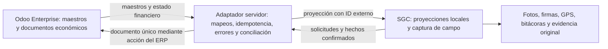

# Auditoría de solapamiento SGC ↔ Odoo Enterprise

Fecha: 15 de octubre de 2026. Repositorio `techcsd/SGC`, commit `f755dbfed1f8adcb740a852d59b4eabdcc4c0350`.

## Dictamen

**SGC contiene capacidades de ERP que se solapan con Odoo Enterprise: maestros de proveedores/productos/vehículos, compras, existencias, gastos, personal, asistencia, ausencias y mantenimiento.** Los primeros candidatos a consolidación son los maestros y los documentos económicos. La recomendación es que Odoo sea la fuente maestra de esos datos cuando sus módulos estén habilitados y el flujo se haya validado; SGC puede conservar la interfaz de campo, sus evidencias y una proyección local con identificadores externos.

**No hay evidencia para declarar que una tabla concreta pueda borrarse hoy.** Solapamiento funcional no equivale a duplicación de registros ni a redundancia eliminable. SGC también implementa procesos específicos de construcción y logística cuya sustitución por una aplicación estándar de Odoo no está demostrada.

La edición **Enterprise está confirmada por el usuario**. La versión, alojamiento, plan, compañía, módulos instalados y personalizaciones de la instancia real no se han confirmado. La comparación usa documentación oficial de **Odoo 19.0** como catálogo de capacidades; no afirma que esa sea la versión instalada ni que todas las aplicaciones estén disponibles/configuradas en ella.

## Alcance y evidencia

- Codegraph se consultó sobre `/Users/Shared/github/techcsd_sgc`, con exploraciones del importador, Transporte v3 y Proyectos. Su índice permite rastrear símbolos/callers TypeScript; el SQL se revisó directamente con búsquedas estáticas.
- Se inspeccionaron servicios Angular, modelos, importador, pruebas existentes, documentación y SQL versionado. **No se ejecutaron migraciones, despliegues, escrituras remotas ni llamadas a una instancia Odoo.**
- Las referencias `archivo:línea` corresponden al checkout anterior. Las rutas abreviadas `services/` son `src/shared/services/`; `sql/` y `docs/` son relativas a la raíz.
- **R** = entidad referenciada por código activo o por SQL; **D** = existe `CREATE TABLE` en SQL versionado; **H** = entidad histórica/deprecada según SQL posterior. Ni R ni D confirman que una tabla exista o tenga datos en dev/prod. Varias tablas base se usan/alteran pero no tienen su DDL inicial en `sql/`.
- Confianza alta significa evidencia clara de la capacidad en el código y del equivalente en Odoo; la posibilidad de sustitución sigue condicionada a validar la instancia y el negocio.

## Integración existente: importación de archivos, no sincronización operativa demostrada

El flujo encontrado es **exportar CSV/XLSX desde Odoo → subir archivo → mapear columnas → transformar → llamar RPC Supabase**. `src/shared/components/importar-odoo/importar-odoo.ts:67` lee el archivo y `:159` ejecuta la importación. `services/importador.service.ts:30` declara exactamente tres entidades:

| Entidad SGC | Modelo Odoo que el importador declara | Qué escribe el SQL de reimportación |
| --- | --- | --- |
| `proveedores` | `res.partner` | Busca por `odoo_ref`, luego RNC/nombre; actualiza nombre, RNC, contacto, teléfono, correo, dirección y activo (`sql/2026-09-29-cc4b-importar-odoo-ref.sql:41`). |
| `vehiculos` | `fleet.vehicle` | Busca por `odoo_ref`, luego placa; al existir actualiza marca/modelo/color y referencia; **no actualiza placa/tipo/activo** (`sql/2026-09-29-cc4b-importar-odoo-ref.sql:101`). |
| `articulos` | `product.template` | Busca por `odoo_ref`, luego código/nombre; al existir **solo actualiza `odoo_ref`**, aunque incrementa `actualizados`; no refresca nombre/código/categoría/unidad (`sql/2026-09-29-cc4b-importar-odoo-ref.sql:150`). |

`sql/2026-09-29-cc4-odoo-ref.sql:15` añade `odoo_ref` y tres índices únicos parciales. `services/importador.service.ts:209` envía las filas a los RPC `importar_*`; no hace una llamada al servidor Odoo. La búsqueda en `src/`, `supabase/` y `scripts/` no encontró un cliente Odoo que ejecute autenticación, `execute_kw`, `/jsonrpc`, `/xmlrpc` o `/json/2`. Esto limita la conclusión al código de este repo: podría existir una integración externa no versionada aquí.

`services/importador-odoo.service.spec.ts:14` contiene pruebas de encabezados, normalización y continuidad de filas. Su encabezado indica que **no toca Supabase**; esas pruebas no certifican idempotencia del RPC ni una integración con Odoo. No se ejecutaron en esta auditoría.

## Matriz de funcionalidades y tablas candidatas

P1 = decidir primero por riesgo de doble maestro o doble registro económico. P2 = sustitución condicionada a validar flujo. P3 = conservar especialización hasta demostrar equivalencia. Los modelos Odoo fuera de las tres filas del importador se presentan como **mapeos técnicos propuestos**, a confirmar en el catálogo de modelos de la instancia.

| Pri. / confianza | Funcionalidad y entidades SGC | Evidencia local | Equivalente Odoo Enterprise y condición | Fuente maestra / decisión recomendada |
| --- | --- | --- | --- | --- |
| **P1 / alta** | Proveedores y transportistas: `proveedores` (R), `proveedores_transporte` (D/H), `proveedor_transporte_map` (D). | `services/proveedores.service.ts:60`; `sql/2026-08-26-ba-fase1-transporte-v3-schema.sql:30`; `sql/2026-09-01-bf2c-transporte-usa-proveedores.sql:90`. | Contacts y proveedores compartidos con Purchase/Accounting; `res.partner` ya reconocido por importador. [Contacts](https://www.odoo.com/documentation/19.0/applications/essentials/contacts.html). | **Odoo: identidad fiscal/contacto**. SGC: ratificación, ubicación y rol operativo de transportista. Consolidar alta/cambios; preservar UUID/FK local. |
| **P1 / alta** | Catálogo de materiales: `articulos`, `categorias_inventario` (R), `unidades` (D), `articulo_alias` (D), `articulo_imagenes` (D). | `services/articulos.service.ts:37`; `sql/2026-07-08-unidades.sql:6`; `sql/2026-08-21-au12-apodos-articulos.sql:11`. | Productos, categorías y unidades de Inventory/Purchase; `product.template` ya reconocido. Odoo dispone de conversión de unidades. [UoM](https://www.odoo.com/documentation/19.0/applications/inventory_and_mrp/inventory/product_management/configure/uom.html). | **Odoo: catálogo, unidades y compras**; SGC: alias de campo e imágenes si se justifica. Acordar producto vs variante y empaque antes de mapear cantidades. |
| **P1 / alta** | Compras y aprobación: `ordenes_compra`, `orden_compra_items` (R), `solicitudes_compra`, `solicitud_compra_items` (D), `solicitud_compra_adjuntos` (D). | `services/ordenes-compra.service.ts:48`; `sql/2026-07-02-solicitudes.sql:116`; `services/tecnologia.service.ts:343`; `sql/2026-10-14-co8-compras-tec-cotizacion.sql:32`. | Purchase: cotización/OC y vínculo con recepción y factura. Propuesta de mapeo: `purchase.order`/líneas. [Control de facturación](https://www.odoo.com/documentation/19.0/applications/inventory_and_mrp/purchase/manage_deals/control_bills.html). | **Odoo: OC e importes comprometidos**. SGC puede originar solicitud y guardar aprobación especializada; una solicitud aprobada debe corresponder a una sola OC del ERP. |
| **P1 / alta** | Recepciones/despachos: `entradas_inventario`, `detalle_entradas`, `salidas_inventario`, `detalle_salidas` (R), `recepcion_confirmaciones`, `salida_firmas` (D). | `services/entradas.service.ts:59`; `sql/2026-07-03-po-receiving.sql:16`; `services/salidas.service.ts:85`; `sql/2026-07-30-ac7-conduce-firmas.sql:17`. | Inventory + Purchase cubren recepción vinculada a OC; relación operativa propuesta: transferencias/movimientos Odoo. [Facturas y compras](https://www.odoo.com/documentation/19.0/applications/inventory_and_mrp/purchase/manage_deals/manage.html). | **Odoo: movimiento validado** si se adopta Inventory. **SGC: fotos, firma y confirmación del chofer/receptor**. La confirmación física debe publicar una sola operación, con reintentos idempotentes. |
| **P1 / alta** | Existencias/almacenes: `bodegas`, `stock_por_bodega`, `conteos_inventario`, `conteo_items` (R), `stock_apertura`, `stock_cuarentena`, `stock_cuarentena_mov` (D). | `services/stock.service.ts:19`; `services/inventario-almacen.service.ts:112`; `sql/2026-09-08-bl4-conteo-fisico.sql:16`; `sql/2026-09-01-bg4-retiro-material-schema.sql:95`. | Inventory administra almacenes, ubicaciones y ajustes físicos. Propuesta: bodegas→almacén/ubicación, no correspondencia automática 1:1. [Almacenes/ubicaciones](https://www.odoo.com/documentation/19.0/applications/inventory_and_mrp/inventory/warehouses_storage/inventory_management.html), [conteos](https://www.odoo.com/documentation/19.0/applications/inventory_and_mrp/inventory/warehouses_storage/inventory_management/count_products.html). | **Un solo libro de stock**. Odoo es candidato maestro si cubre el circuito; SGC conserva proyección y evidencia. Hasta homologar apertura, unidades, cuarentena y devoluciones, SGC sigue siendo autoridad operativa. |
| **P1 / alta** | Gastos de obra: `gastos_directos`, `gasto_categorias` (D) y agregados de gasto por proyecto. | `sql/2026-08-17-as14-as23-compras-gastos-zona.sql:55`; `services/proyectos.service.ts:144` y `:388`. | Expenses registra gastos/recibos; Accounting lleva facturas, impuestos y pagos. El gasto directo debe clasificarse por su naturaleza, sin asumir que todo sea un gasto de empleado. [Expenses](https://www.odoo.com/documentation/19.0/applications/finance/expenses/log_expenses.html), [Vendor bills](https://www.odoo.com/documentation/19.0/applications/finance/accounting/vendor_bills.html). | **Odoo: reconocimiento contable e impuestos**. SGC: captura y evidencia. Separar comprometido, recibido, facturado y pagado en KPIs. |
| **P1 / alta** | Estado de pago a transportista: `viajes_transporte.estado_pago` (D). | `sql/2026-08-26-ba-fase1-transporte-v3-schema.sql:129` y `:159`; `services/transporte-v3.service.ts:164`. | Accounting permite registrar facturas y pagos. El propio SQL SGC dice que **los montos viven en Odoo**. [Vendor bills](https://www.odoo.com/documentation/19.0/applications/finance/accounting/vendor_bills.html). | **Odoo: factura/pago y saldo**. SGC: viaje, evidencia y proyección del estado. Evitar que el botón manual de pagado produzca una verdad financiera independiente. |
| **P1 / alta** | Maestro de flota: `vehiculos` (R), `vehiculo_asignaciones`, `vehiculo_usos` (D); conductores (R). | `services/vehiculos.service.ts:134`; `sql/2026-07-14-mejoras-flota.sql:18`; `sql/2026-08-10-ak20-vehiculos-en-uso-conductor.sql:57`. | Fleet gestiona vehículos/conductor, contratos y odómetro; `fleet.vehicle` ya reconocido. [Fleet](https://www.odoo.com/documentation/19.0/applications/hr/fleet.html). | **Odoo: identidad del vehículo y contratos**, si Fleet está instalado. SGC: uso efectivo, disponibilidad y autorización de salida. El conductor de Fleet no equivale sin más a un usuario autenticado SGC. |
| **P2 / alta** | Mantenimiento: `mantenimientos` (R), `mantenimiento_adjuntos` (D); `vehiculo_accidentes`, `vehiculo_danos` (D). | `services/mantenimientos.service.ts:41`; `sql/2026-10-05-cg13-mantenimiento-adjuntos.sql:9`; `sql/2026-07-21-act3-p9-s22s24-accidentes-multas.sql:12`. | Fleet registra servicios y costos; Maintenance cubre mantenimiento de equipos. No asumir que ambos sean intercambiables. [Fleet Services](https://www.odoo.com/documentation/19.0/applications/hr/fleet/service.html), [Maintenance](https://www.odoo.com/documentation/19.0/applications/inventory_and_mrp/maintenance.html). | **Odoo: servicio/costo y factura asociada**. SGC conserva preuso, fotos, controles de km y bloqueo operacional hasta validar equivalente. |
| **P2 / alta** | RRHH: `empleados`, `asistencia` (R), `solicitudes_ausencia`, `empleado_documentos`, `empleado_asignaciones` (D). | `services/empleados.service.ts:25`; `services/asistencia.service.ts:15`; `sql/2026-07-07-rrhh-improvements.sql:33`; `sql/2026-08-04-af33-empleado-asignaciones.sql:14`. | Employees, Attendances y Time Off cubren ficha, marcaciones y solicitudes de ausencia. [Employees](https://www.odoo.com/documentation/19.0/applications/hr/employees.html), [Attendances](https://www.odoo.com/documentation/19.0/applications/hr/attendances.html), [Time Off](https://www.odoo.com/documentation/19.0/applications/hr/time_off.html). | **Odoo: vínculo laboral y ausencias** si RRHH lo adopta; SGC: asignación al frente y captura de campo. No equiparar `personal_obra` con empleado de nómina sin reconciliar identidades/contratistas. |
| **P2 / alta** | Proyectos/tareas: `proyectos`, `fases_proyecto` (R), `tareas`, `tarea_comentarios`, `cronograma_tareas`, `cronograma_tarea_bitacoras` (D). | `services/proyectos.service.ts:251`; `sql/2026-07-07-tareas-module.sql:11`; `sql/2026-07-28-y15-cronograma-schema.sql:10`; `services/cronograma.service.ts:61`. | Project tiene tareas, etapas, subtareas y dependencias; Timesheets registra/valida tiempo por proyecto/persona. [Tasks](https://www.odoo.com/documentation/19.0/applications/services/project/tasks.html), [Timesheets](https://www.odoo.com/documentation/19.0/applications/services/timesheets.html). | **Definir dueño del proyecto y sus tareas genéricas**. SGC conserva cronograma ligado a bitácoras/estructura física mientras no haya prueba funcional equivalente. No sincronizar dos estados editables sin reglas. |
| **P2 / media** | Equipos y activos: `tec_equipos`, `tec_equipo_historial`, `tec_matriz` (D), `activos_fijos` (R). | `sql/2026-07-12-tecnologia-module.sql:26`; `services/tecnologia.service.ts:187`; `services/activos.service.ts:43`. | Maintenance para equipos; Accounting para activos/depreciación. Son conceptos distintos: un portátil asignado no implica un activo contable individual. [Maintenance setup](https://www.odoo.com/documentation/19.0/applications/inventory_and_mrp/maintenance/maintenance_setup.html), [Assets, documentación 19.0 NL](https://www.odoo.com/documentation/19.0/nl/applications/finance/accounting/vendor_bills/assets.html). | **Odoo: activo contable/depreciación**; dueño operativo por decidir. Matriz puesto→herramientas y custodia requieren prueba específica; no eliminarlas por tener Accounting. |
| **P2 / media** | Archivos/contratos: `documentos`, `documentos_proyecto`, `empleado_documentos`, `expediente_obra` (D), `contratos`, `expedientes_legales` (R). | `sql/2026-07-16-act6-documentos.sql:15`; `sql/2026-07-12-expediente-obra.sql:15`; `services/legal.service.ts:35` y `:162`. | Documents administra archivos y Sign prepara/firma documentos. Esto no demuestra equivalencia con expediente legal, checklist de obra ni valor probatorio de cada captura. [Documents](https://www.odoo.com/documentation/19.0/applications/productivity/documents.html), [Sign](https://www.odoo.com/documentation/19.0/applications/productivity/sign/sign_document.html). | **Un repositorio documental maestro por tipo**, con enlace/permisos/versionado; conservar metadatos y evidencia SGC donde el flujo lo necesite. |
| **P3 / alta en especialización** | Combustible: `registros_combustible` (R), `combustible_facturas`, `conciliaciones_combustible`, `conciliacion_combustible_detalle`, `combustible_tarjeta_map` (D). | `sql/2026-09-23-bx4-combustible-facturas.sql:24`; `sql/2026-07-22-t4-estaciones-conciliacion.sql:40`; `services/combustible-conciliacion.service.ts:311` y `:381`. | Accounting puede llevar la factura/pago; Fleet los costos. No se demostró en módulos estándar el parser TotalEnergies, emparejamiento tarjeta/chofer/vehículo ni anomalías de echadas. [Vendor bills](https://www.odoo.com/documentation/19.0/applications/finance/accounting/vendor_bills.html), [Fleet Services](https://www.odoo.com/documentation/19.0/applications/hr/fleet/service.html). | **Odoo: factura fiscal, costo y pago**; **SGC: detalle de echadas, conciliación operativa, PDF original/hash y diagnóstico**. Enlazar factura sin duplicar el gasto. |

## Qué conservar como especialización de SGC

| Proceso | Entidades/evidencia | Por qué no declararlo redundante |
| --- | --- | --- |
| Ejecución de obra y liberación de vaciados | `obra_elementos`, `obra_vaciados`, `obra_no_conformidades`: `sql/2026-07-13-recomendaciones.sql:208`; `services/obra-ejecucion.service.ts:25`. | Elemento físico, eje/bloque, vaciado y NC que puede bloquearlo; el código actual tiene servicio de ejecución aunque un comentario inicial del DDL dijera «sin UI aún». La sustitución necesita demostrar esas reglas. |
| Cubicaciones/subcontratos y producción | `obra_subcontratistas`, `obra_subcontratista_frentes`, `obra_cubicaciones`, `obra_cubicacion_eventos`: `sql/2026-08-06-ag16-fase3-subcontratistas-cubicaciones.sql:14`; cartillas/atados/piezas: `sql/2026-09-15-br-bo10-cartillas-schema.sql:39`. | Solapamiento económico parcial no prueba equivalencia del cálculo, avances físicos, estados y evidencia. Odoo podría recibir el documento económico resultante. |
| Transporte y conformidad de entrega | `conduces_externos`, `viajes_transporte`: `sql/2026-08-26-ba-fase1-transporte-v3-schema.sql:63`; fotos/firmas en `services/transporte-v3.service.ts:179`; tracking en `sql/2026-08-04-af27-transporte-v2-fase4-tracking.sql:15`. | Captura de placa/carga, geografía, chofer y receptor; un albarán del ERP no demuestra equivalencia de esta experiencia ni de sus evidencias. |
| Personal de obra y documentación de firma | `personal_obra`, fotos y firmas: `sql/2026-08-14-ar1-registro-personal-obra.sql:52`; `personal_obra_firma_lineas`: `sql/2026-10-02-cf1-firmas-empleador-testigos.sql:15`. | El dominio mezcla identidades y relaciones que deben clasificarse antes de mapear a Employees/Contacts/Sign. |
| Incentivos/checklists y controles internos | `incentivo_semana`, `incentivo_aprobacion`: `sql/2026-08-20-at1-at4-incentivo-choferes.sql:77`; `checklists_vehiculo`: `sql/2026-07-12-flota-checklists.sql:39`. | No se verificó que Payroll/Fleet replique fórmula, aprobación, antifraude y requisitos fotográficos. No se afirma cobertura de nómina dominicana. |
| Infraestructura de aplicación | RLS/roles, notificaciones, outbox, dispositivos, `importaciones`/`importaciones_mapeo`, ledger de entornos. | Son soporte de SGC. La presencia de aplicaciones Odoo no elimina su necesidad mientras SGC siga ejecutando procesos de campo. |

## Hallazgos que afectan la decisión

1. **Maestros locales editables + importador = riesgo de divergencia.** `services/proveedores.service.ts:78`, `services/articulos.service.ts:95` y `services/vehiculos.service.ts:134` muestran acceso local; los RPC del importador no instauran una política única de autoridad. Elegir campos maestros y tratamiento de cambios locales antes de automatizar la importación.
2. **La importación de artículos no refresca el catálogo existente.** El `update` de `sql/2026-09-29-cc4b-importar-odoo-ref.sql:170` solo vincula `odoo_ref`. Un contador de actualizados no prueba sincronización de descripción, unidad o categoría. El importador de vehículos también actualiza un subconjunto.
3. **La clave externa aún carece de contexto de instancia/modelo.** Los índices `odoo_ref` son por tabla, y el mapeador acepta tanto External ID como Database ID (`services/importador.service.ts:25`). Si se mezclan exports de bases distintas, un valor numérico no identifica globalmente el registro. Recomendación de diseño: instancia/base + modelo + identificador externo estable, conservando UUID SGC. Es una mejora propuesta, no una estructura existente.
4. **Categoría y UoM tienen transformaciones con pérdida potencial.** El importador toma la hoja de la ruta y normaliza unidades a códigos (`services/importador.service.ts:70` y `:134`); no importa árbol/identificadores de categoría ni factores de conversión de Odoo. SGC ya guarda factor de empaque y cantidad en unidad base (`sql/2026-09-09-bm5-factor-empaque-schema.sql:38`). Un nombre coincidente de unidad no garantiza cantidades equivalentes.
5. **OC→recepción no equivale a conciliación de tres vías.** `sql/2026-07-03-po-receiving.sql:2` documenta un diseño inicialmente reducido por líneas libres/artículo nullable. Esa descripción histórica no acredita la distribución de datos actual. Odoo documenta control por cantidades recibidas y tres vías; antes de consolidar hay que validar mapeo de líneas y facturas con datos de dev.
6. **Dos métricas de gasto pueden significar cosas distintas.** `services/proyectos.service.ts:388` calcula «gasto real» sumando OC aprobadas/recibidas. El SQL `compras_de_proyecto` documenta OC + compras de ferretería + gastos directos (`sql/2026-08-17-as14-as23-compras-gastos-zona.sql:7`). No se comprobó doble conteo en datos reales, pero sumar ese indicador a facturas de Odoo sin enlace documental puede mezclar compromiso, recepción y gasto contable.
7. **`proveedores_transporte` es un caso de redundancia interna histórica ya abordada.** BF2b dice conservar respaldo y marcarlo deprecado (`sql/2026-09-01-bf2b-merge-transporte-HELD.sql:100`); BF2c lista transportistas desde `sgc.proveedores` (`:104`). El nombre `HELD` no prueba que nunca se aplicara: el propio archivo afirma aplicación, sin que esta auditoría la certifique. Mantener tabla/mapeo hasta verificar FKs, RPC y datos vivos; no contar dos maestros vigentes por sus dos DDL.
8. **Un archivo de factura SGC no es un asiento contable.** `combustible_facturas.estado` solo admite subida/parseada/importada/fallida, conserva hash/PDF y diagnóstico; no hay estado de contabilización ni vínculo Odoo en esa definición (`sql/2026-09-23-bx4-combustible-facturas.sql:24`). La tabla es candidata a enlazar, no a borrar por llamarse facturas.

## Arquitectura objetivo propuesta

Es una propuesta, **no una integración implementada**. Un objeto no debe tener dos dueños editando los mismos campos. La copia SGC puede seguir siendo necesaria por FKs, rendimiento y experiencia de campo, aunque deje de ser maestra. Publicar eventos mediante las acciones de negocio del ERP y reconciliar sus resultados; no copiar estados/stock por escrituras SQL directas.

Para el adaptador hay que confirmar versión/plan/alojamiento: la documentación 19.0 presenta JSON-2 como nuevo en 19 y limita la API externa a planes Custom; **Enterprise por sí solo no confirma ese plan**. Los modelos y métodos disponibles dependen de la base. No escoger `/json/2` para una instancia 16/17 ni inferir disponibilidad de acceso por la edición. [API externa oficial 19.0](https://www.odoo.com/documentation/19.0/developer/reference/external_api.html).

## Orden de consolidación y prueba necesaria

1. **Inventario real, solo lectura:** identificar URL/base/versión/compañías Odoo, módulos instalados y permisos; comparar catálogo de modelos/campos con el esquema Supabase/ledger de dev y prod. Reconciliar conteos, identificadores y muestras anonimizadas. No consultar una instancia ajena por compartir un conector.
2. **P1: proveedores + artículos + vehículos:** acordar matriz de propiedad por campo, referencias externas y tratamiento de bajas; probar alta, reimportación, renombrado, archivo, colisión y cambio de unidad. Inicialmente preservar los UUID y FKs locales.
3. **P1: solicitud→OC→recepción→factura→pago:** probar un circuito en dev con una OC y recepción parcial, devolución, anulación, gasto directo y viaje pagado. La misma entrada reintentada no debe generar otro documento ERP ni otro costo.
4. **P1: libro de existencias:** conciliar apertura + entradas − salidas ± ajustes por artículo/ubicación/unidad; demostrar cuarentena, devoluciones y conteo antes de cambiar la fuente maestra. No superponer saldos iniciales a movimientos históricos ya importados.
5. **P2: RRHH, mantenimiento, proyectos y documentos:** comparar flujos reales con usuarios responsables; distinguir empleado, contratista y usuario SGC; conservar reglas y evidencias específicas donde Odoo estándar no las haya demostrado.
6. **Retiro eventual de escritura local:** solo tras observar reconciliación estable y verificar consumidores/RLS/FKs/archivo histórico. Retirar formularios duplicados o convertirlos en solicitudes/proyecciones antes de plantear eliminación física de tablas. Cualquier migración sigue `docs/ENTORNOS.md`: dev primero y validación antes de prod.

## Límites y pendientes

- No se midió el uso ni el costo de mantener módulos redundantes; prioridad expresa riesgo y claridad de solapamiento, no ahorro cuantificado.
- No se verificaron tablas/filas ni migraciones aplicadas en Supabase real, módulos Odoo instalados, API autenticada ni funcionamiento de pantallas. No hay afirmación de duplicación de registros entre sistemas.
- Los SQL históricos pueden contener definiciones reemplazadas, comentarios de operación o archivos de respaldo. La auditoría usa modificaciones posteriores cuando se identificaron, sin reconstruir/ejecutar toda la historia ni certificar el esquema final.
- La documentación 19.0 consultada describe capacidades estándar; la equivalencia de reglas locales y de versiones anteriores requiere validación. No se usaron módulos de terceros del marketplace como prueba de capacidad estándar.
- Resultado verificable de esta tarea: auditoría estática con trazabilidad a código/SQL y fuentes oficiales; **no autorización ni plan ejecutado de eliminación**.
