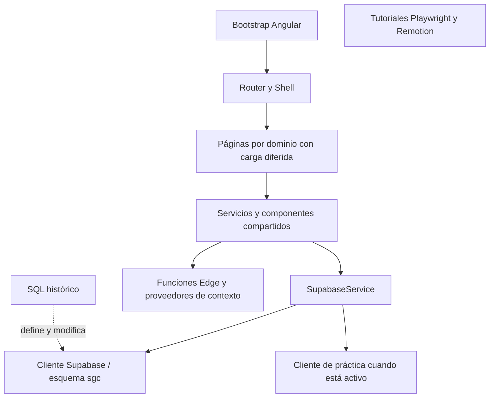

# Inventario de SGC con Codegraph

Fecha: 15 de octubre de 2026 (America/Santo_Domingo).
Repositorio: https://github.com/techcsd/SGC · rama `main` · versión `1.189.0`.
Commit inventariado: `f755dbfed1f8adcb740a852d59b4eabdcc4c0350`.

## Alcance y verificación

Clonado directamente en `/Users/Shared/github/techcsd_sgc`. El conector nativo de GitHub confirmó el repositorio y su rama predeterminada `main`. Git se utilizó para el clonado local. Análisis estático del checkout: no se instalaron dependencias, no se ejecutó la aplicación ni se consultó una base de datos remota.

Codegraph 1.1.3 se inicializó con `codegraph init .`. Se verificaron el estado del índice, consultas mediante el MCP y el CLI, y la integridad SQLite (`PRAGMA integrity_check = ok`). El índice no registra errores de parsing ni referencias pendientes en sus tablas; esto no acredita resolución completa de dependencias dinámicas.

## Tamaño y cobertura

| Medida | Cantidad |
| --- | ---: |
| Archivos versionados | 2,030 |
| Archivos indexados | 667 |
| Nodos del grafo | 18,021 |
| Relaciones | 46,056 |
| Archivos de servicios Angular (`*.service.ts`, bajo `src/`) | 117 |
| Guards (`*.guard.ts`) | 12 |
| Directorios de páginas | 34 |
| Archivos de rutas | 13 |
| Declaraciones de `path` | 201 |
| Funciones bajo `supabase/functions/` con directorio propio, sin `_shared` | 41 |
| Archivos SQL versionados | 761 |
| Archivos de prueba bajo `src/` | 9 |
| Archivos de prueba bajo `qa/` | 3 |

Las declaraciones de `path` incluyen rutas vacías, redirects, parámetros y wildcard. No equivalen a pantallas únicas ni acreditan que todas las páginas de disco sean alcanzables. Los SQL son archivos históricos, no 761 tablas ni 761 migraciones aplicadas.

| Lenguaje indexado | Archivos | Nodos |
| --- | ---: | ---: |
| javascript | 109 | 1,482 |
| tsx | 22 | 302 |
| typescript | 535 | 16,237 |
| yaml | 1 | 0 |

Quedan fuera del grafo semántico los 761 SQL, 228 HTML, 228 SCSS y otros documentos/assets/configuraciones. Estos archivos sí se contabilizaron mediante `git ls-files`. El índice cubre código de `src/` (485 archivos), `scripts/` (66), `tutoriales/` (58), `supabase/` (42), `qa/` (14), un workflow YAML y la configuración Playwright.

## Arquitectura observada



- Entrada: [`src/main.ts`](../src/main.ts) → [`app.config.ts`](../src/app/app.config.ts) → [`app.routes.ts`](../src/app/app.routes.ts). Angular 21.2, componentes standalone y rutas con `loadComponent`/`loadChildren`.
- Acceso: 12 guards en [`src/app/core/guards/`](../src/app/core/guards/); autenticación, módulos, submódulos y roles. El grafo no valida la eficacia de RLS ni permisos desplegados.
- Datos: [`SupabaseService`](../src/app/core/services/supabase.service.ts) crea el cliente con esquema `sgc` y selecciona el cliente de práctica cuando corresponde. Configuración local requerida en `environment.ts`, generado por `npm run env:dev`.
- UI y estado: [`src/shared/`](../src/shared/) agrupa servicios, modelos, utilidades, componentes, i18n, movimiento y proveedores de contexto. Signals y RxJS aparecen en el código.
- Backend versionado: [`supabase/functions/`](../supabase/functions/) y [`sql/`](../sql/). El estado aplicado en Supabase no se verificó.
- Dependencias funcionales: TipTap para edición, PDF.js/Mammoth/XLSX para documentos e importaciones, QR, DOMPurify, Vercel Analytics/Speed Insights.
- Tutoriales: proyecto independiente Playwright/FFmpeg en [`tutoriales/`](../tutoriales/) y React 19/Remotion 4 en [`tutoriales/motion/`](../tutoriales/motion/). No forman parte del frontend Angular.

## Inventario de páginas por directorio

Cada fila cuenta archivos presentes en el checkout; no es una certificación funcional.

| Directorio bajo `src/app/pages/` | Archivos | TS | HTML | SCSS |
| --- | ---: | ---: | ---: | ---: |
| [admin](../src/app/pages/admin/) | 64 | 22 | 21 | 21 |
| [ajustes-notificaciones](../src/app/pages/ajustes-notificaciones/) | 3 | 1 | 1 | 1 |
| [apoyo-transporte](../src/app/pages/apoyo-transporte/) | 3 | 1 | 1 | 1 |
| [app-movil](../src/app/pages/app-movil/) | 3 | 1 | 1 | 1 |
| [asistente](../src/app/pages/asistente/) | 3 | 1 | 1 | 1 |
| [auth](../src/app/pages/auth/) | 7 | 3 | 2 | 2 |
| [bitacora](../src/app/pages/bitacora/) | 40 | 14 | 13 | 13 |
| [compras](../src/app/pages/compras/) | 11 | 5 | 3 | 3 |
| [configuracion](../src/app/pages/configuracion/) | 3 | 1 | 1 | 1 |
| [dashboard](../src/app/pages/dashboard/) | 3 | 1 | 1 | 1 |
| [direccion](../src/app/pages/direccion/) | 3 | 1 | 1 | 1 |
| [documentos](../src/app/pages/documentos/) | 13 | 5 | 4 | 4 |
| [dudas](../src/app/pages/dudas/) | 4 | 2 | 1 | 1 |
| [flota](../src/app/pages/flota/) | 75 | 27 | 24 | 24 |
| [forbidden](../src/app/pages/forbidden/) | 3 | 1 | 1 | 1 |
| [incentivos](../src/app/pages/incentivos/) | 3 | 1 | 1 | 1 |
| [inventario](../src/app/pages/inventario/) | 83 | 29 | 27 | 27 |
| [legal](../src/app/pages/legal/) | 16 | 6 | 5 | 5 |
| [mensajes](../src/app/pages/mensajes/) | 6 | 2 | 2 | 2 |
| [mi-rendimiento](../src/app/pages/mi-rendimiento/) | 3 | 1 | 1 | 1 |
| [mis-choferes](../src/app/pages/mis-choferes/) | 3 | 1 | 1 | 1 |
| [notas](../src/app/pages/notas/) | 6 | 2 | 2 | 2 |
| [obra](../src/app/pages/obra/) | 19 | 7 | 6 | 6 |
| [perfil](../src/app/pages/perfil/) | 3 | 1 | 1 | 1 |
| [politicas](../src/app/pages/politicas/) | 5 | 2 | 2 | 1 |
| [practica](../src/app/pages/practica/) | 3 | 1 | 1 | 1 |
| [proyectos](../src/app/pages/proyectos/) | 43 | 15 | 14 | 14 |
| [rrhh](../src/app/pages/rrhh/) | 13 | 5 | 4 | 4 |
| [solicitudes-movimiento](../src/app/pages/solicitudes-movimiento/) | 3 | 1 | 1 | 1 |
| [soporte](../src/app/pages/soporte/) | 3 | 1 | 1 | 1 |
| [tareas](../src/app/pages/tareas/) | 10 | 4 | 3 | 3 |
| [tecnologia](../src/app/pages/tecnologia/) | 46 | 16 | 15 | 15 |
| [trabajos-transporte](../src/app/pages/trabajos-transporte/) | 3 | 1 | 1 | 1 |
| [verificar](../src/app/pages/verificar/) | 3 | 1 | 1 | 1 |

Dominios con rutas hijas: administración, bitácora, compras, documentos, flota, inventario, legal, obra, proyectos, RR. HH., tareas y tecnología. La ruta raíz incorpora dashboard, dirección, configuración, mensajes, asistente, incentivos, transporte, notas, autenticación y páginas públicas.

## Catálogo de rutas

Se listan literales declarados por archivo; las rutas hijas son relativas a su padre. `∅` representa el path vacío.

| Archivo | Paths declarados |
| --- | --- |
| [src/app/app.routes.ts](../src/app/app.routes.ts) | `auth`, `auth/set-password`, `verificar/:carnet`, `politicas/eliminar-cuenta`, `politicas/:doc`, `∅`, `∅`, `dashboard`, `direccion`, `soporte`, `app-movil`, `dudas`, `practica`, `configuracion`, `perfil`, `ajustes/notificaciones`, `inventario/por-firmar`, `transporte/por-firmar`, `por-firmar`, `inventario`, `admin`, `flota`, `bitacora`, `documentos`, `compras`, `rrhh`, `proyectos`, `legal`, `obra`, `tareas`, `tecnologia`, `mensajes`, `asistente`, `incentivos`, `mi-rendimiento`, `transporte/apoyo`, `solicitudes-movimiento`, `transporte/trabajos`, `transporte/mis-choferes`, `notas`, `notas/nueva`, `notas/:id`, `403`, `**` |
| [src/app/pages/admin/admin.routes.ts](../src/app/pages/admin/admin.routes.ts) | `∅`, `usuarios`, `roles`, `usuarios-test`, `reportes`, `unidades`, `importar`, `bitacora-catalogos`, `parametros`, `app-versiones`, `historial-versiones`, `otros-valores`, `auditoria`, `notificaciones`, `matriz-notificaciones`, `empresa`, `orden-modulos`, `almacenes-duplicados`, `usuarios-duplicados`, `solicitudes-eliminacion`, `animaciones` |
| [src/app/pages/bitacora/bitacora.routes.ts](../src/app/pages/bitacora/bitacora.routes.ts) | `∅`, `nueva`, `orden-trabajo`, `ordenes-trabajo`, `orden-trabajo/:id`, `historial`, `dashboard`, `cobertura`, `moldes`, `cartillas`, `cartillas/:id`, `mi-proyecto`, `solicitudes-material`, `solicitudes-compra`, `entregas`, `entregas/:id/conduce` |
| [src/app/pages/compras/compras.routes.ts](../src/app/pages/compras/compras.routes.ts) | `∅`, `proveedores`, `proveedores/importar`, `ordenes`, `solicitar`, `reportes` |
| [src/app/pages/documentos/documentos.routes.ts](../src/app/pages/documentos/documentos.routes.ts) | `∅`, `generar`, `plantillas`, `historial`, `ver/:id` |
| [src/app/pages/flota/flota.routes.ts](../src/app/pages/flota/flota.routes.ts) | `∅`, `vehiculos`, `vehiculos/importar`, `vehiculos/:id`, `reporte-semanal`, `mantenimientos`, `conductores`, `conductores-estado`, `conductores/:id`, `choferes-privados`, `choferes-privados/:id`, `accidentes`, `combustible`, `combustible-log`, `combustible-dashboard`, `conciliacion-combustible`, `rutas`, `seguimiento`, `rutas-activas`, `recorrido-diario`, `checklists`, `panel-dia`, `avisos`, `responsabilidad`, `reportes` |
| [src/app/pages/inventario/inventario.routes.ts](../src/app/pages/inventario/inventario.routes.ts) | `∅`, `articulos`, `articulos/importar`, `activos`, `entradas`, `salidas`, `conduces`, `confirmaciones`, `requisiciones`, `retiros`, `material-no-catalogado`, `conduces-por-implementar`, `conduces-externos`, `conduces-externos/:id`, `conduce-externo/nuevo`, `proveedores-transporte`, `lugares-por-registrar`, `movimientos`, `salidas/:id/conduce`, `bodegas`, `almacen/:id`, `almacen/obra/:proyectoId`, `categorias`, `conteos`, `apertura`, `ajuste-real`, `reposicion`, `reportes` |
| [src/app/pages/legal/legal.routes.ts](../src/app/pages/legal/legal.routes.ts) | `∅`, `expedientes`, `contratos`, `aprobaciones`, `firmas-pendientes`, `configuracion` |
| [src/app/pages/obra/obra.routes.ts](../src/app/pages/obra/obra.routes.ts) | `∅`, `plan-dia`, `no-conformidades`, `checklists`, `subcontratistas`, `avance`, `informes` |
| [src/app/pages/proyectos/proyectos.routes.ts](../src/app/pages/proyectos/proyectos.routes.ts) | `∅`, `nuevo`, `kpi`, `historial`, `clima`, `personal`, `personal/registrar`, `personal/importar`, `cargos`, `personal/:id`, `:id/cronograma`, `:id/cronograma/importar`, `:id/costos`, `:id/compras`, `:id` |
| [src/app/pages/rrhh/rrhh.routes.ts](../src/app/pages/rrhh/rrhh.routes.ts) | `∅`, `empleados`, `asistencia`, `ausencias`, `reportes` |
| [src/app/pages/tareas/tareas.routes.ts](../src/app/pages/tareas/tareas.routes.ts) | `∅`, `mis-tareas`, `gestion`, `historial` |
| [src/app/pages/tecnologia/tecnologia.routes.ts](../src/app/pages/tecnologia/tecnologia.routes.ts) | `∅`, `guia`, `homologacion`, `matriz`, `inventario`, `compras`, `reportes-errores`, `issues`, `qa`, `dev-notes`, `historial-versiones`, `app-versiones`, `monitoreo`, `estadisticas`, `apis-consumo`, `resumen-operaciones`, `consultas-compa`, `outbox-atascados`, `design-system` |

## Dependencias centrales según el grafo

Archivos dependientes distintos por aristas `imports`, `references` o `instantiates`, excluyendo el propio archivo de la clase. Esta métrica de acoplamiento estático ayuda a priorizar revisiones, sin sustituir un análisis de impacto específico.

| Clase | Archivos dependientes | Fuente |
| --- | ---: | --- |
| `SupabaseService` | 133 | [src/app/core/services/supabase.service.ts:7](../src/app/core/services/supabase.service.ts#L7) |
| `Skeleton` | 124 | [src/shared/components/skeleton/skeleton.ts:14](../src/shared/components/skeleton/skeleton.ts#L14) |
| `UserService` | 116 | [src/app/core/services/user.service.ts:10](../src/app/core/services/user.service.ts#L10) |
| `ToastService` | 107 | [src/shared/services/toast.service.ts:18](../src/shared/services/toast.service.ts#L18) |
| `Icon` | 102 | [src/shared/ui/icon/icon.ts:22](../src/shared/ui/icon/icon.ts#L22) |
| `FormDrawer` | 65 | [src/shared/components/form-drawer/form-drawer.ts:19](../src/shared/components/form-drawer/form-drawer.ts#L19) |
| `ProyectosService` | 45 | [src/shared/services/proyectos.service.ts:113](../src/shared/services/proyectos.service.ts#L113) |
| `DatosPruebaViewService` | 39 | [src/shared/services/datos-prueba-view.service.ts:27](../src/shared/services/datos-prueba-view.service.ts#L27) |
| `StaggerDirective` | 36 | [src/shared/motion/stagger.directive.ts:13](../src/shared/motion/stagger.directive.ts#L13) |
| `MotionService` | 25 | [src/shared/services/motion.service.ts:33](../src/shared/services/motion.service.ts#L33) |
| `SignedUrlCache` | 22 | [src/shared/services/signed-url-cache.service.ts:35](../src/shared/services/signed-url-cache.service.ts#L35) |
| `VehiculosService` | 22 | [src/shared/services/vehiculos.service.ts:128](../src/shared/services/vehiculos.service.ts#L128) |

Archivos con mayor cantidad de nodos extraídos:

| Archivo | Nodos |
| --- | ---: |
| [src/app/pages/proyectos/lista/lista.ts](../src/app/pages/proyectos/lista/lista.ts) | 219 |
| [src/app/pages/bitacora/nueva/nueva.ts](../src/app/pages/bitacora/nueva/nueva.ts) | 203 |
| [src/app/pages/inventario/salidas/salidas.ts](../src/app/pages/inventario/salidas/salidas.ts) | 200 |
| [src/app/pages/flota/vehiculos/detalle/vehiculo-detalle.ts](../src/app/pages/flota/vehiculos/detalle/vehiculo-detalle.ts) | 196 |
| [src/app/pages/flota/combustible/combustible.ts](../src/app/pages/flota/combustible/combustible.ts) | 185 |
| [src/app/pages/inventario/entradas/entradas.ts](../src/app/pages/inventario/entradas/entradas.ts) | 177 |
| [src/app/pages/flota/rutas/rutas.ts](../src/app/pages/flota/rutas/rutas.ts) | 172 |
| [src/app/pages/flota/mantenimientos/mantenimientos.ts](../src/app/pages/flota/mantenimientos/mantenimientos.ts) | 163 |
| [src/app/pages/mensajes/mensajes.ts](../src/app/pages/mensajes/mensajes.ts) | 161 |
| [src/app/pages/inventario/requisiciones/requisiciones.ts](../src/app/pages/inventario/requisiciones/requisiciones.ts) | 159 |

## Funciones Edge versionadas

La presencia de una función en el repositorio no demuestra su despliegue o ejecución. Hay además código común bajo `_shared` y un archivo auxiliar en `assistant/`.

- [`acceso-cedula`](../supabase/functions/acceso-cedula/)
- [`admin-crear-usuario-test`](../supabase/functions/admin-crear-usuario-test/)
- [`admin-create-user`](../supabase/functions/admin-create-user/)
- [`admin-deactivate-user`](../supabase/functions/admin-deactivate-user/)
- [`admin-delete-user`](../supabase/functions/admin-delete-user/)
- [`admin-entrar-como`](../supabase/functions/admin-entrar-como/)
- [`admin-fin-impersonacion`](../supabase/functions/admin-fin-impersonacion/)
- [`admin-procesar-eliminacion`](../supabase/functions/admin-procesar-eliminacion/)
- [`admin-resend-invite`](../supabase/functions/admin-resend-invite/)
- [`admin-reset-user-password`](../supabase/functions/admin-reset-user-password/)
- [`admin-set-password`](../supabase/functions/admin-set-password/)
- [`admin-usuario-test-login`](../supabase/functions/admin-usuario-test-login/)
- [`assistant`](../supabase/functions/assistant/)
- [`auth-signout-others`](../supabase/functions/auth-signout-others/)
- [`check-domains`](../supabase/functions/check-domains/)
- [`check-subscriptions`](../supabase/functions/check-subscriptions/)
- [`conductor-crear-acceso`](../supabase/functions/conductor-crear-acceso/)
- [`conductor-login`](../supabase/functions/conductor-login/)
- [`fuel-prices`](../supabase/functions/fuel-prices/)
- [`generar-informe-obra`](../supabase/functions/generar-informe-obra/)
- [`incentivo-diario`](../supabase/functions/incentivo-diario/)
- [`incentivo-semanal`](../supabase/functions/incentivo-semanal/)
- [`leer-recibo`](../supabase/functions/leer-recibo/)
- [`notificar-cronograma`](../supabase/functions/notificar-cronograma/)
- [`notificar-entrega`](../supabase/functions/notificar-entrega/)
- [`notificar-flota`](../supabase/functions/notificar-flota/)
- [`notificar-incidente`](../supabase/functions/notificar-incidente/)
- [`notificar-solicitud`](../supabase/functions/notificar-solicitud/)
- [`notificar-soporte`](../supabase/functions/notificar-soporte/)
- [`notificar-version`](../supabase/functions/notificar-version/)
- [`places-search`](../supabase/functions/places-search/)
- [`resolve-maps-link`](../supabase/functions/resolve-maps-link/)
- [`resumen-semanal-operaciones`](../supabase/functions/resumen-semanal-operaciones/)
- [`reverse-geocode`](../supabase/functions/reverse-geocode/)
- [`routing-directions`](../supabase/functions/routing-directions/)
- [`send-push`](../supabase/functions/send-push/)
- [`snap-to-roads`](../supabase/functions/snap-to-roads/)
- [`solicitar-eliminacion`](../supabase/functions/solicitar-eliminacion/)
- [`sync-weather-obras`](../supabase/functions/sync-weather-obras/)
- [`transcribe-audio`](../supabase/functions/transcribe-audio/)
- [`transcribe-now`](../supabase/functions/transcribe-now/)

## Pruebas y automatización

Archivos de prueba encontrados; no se ejecutaron y no se calculó cobertura:

- [`src/app/app.spec.ts`](../src/app/app.spec.ts)
- [`src/app/core/practica/practica-cliente.spec.ts`](../src/app/core/practica/practica-cliente.spec.ts)
- [`src/app/pages/auth/auth.spec.ts`](../src/app/pages/auth/auth.spec.ts)
- [`src/shared/components/onboarding-web/onboarding-web.perfil.spec.ts`](../src/shared/components/onboarding-web/onboarding-web.perfil.spec.ts)
- [`src/shared/motion/catalogo-movimiento.spec.ts`](../src/shared/motion/catalogo-movimiento.spec.ts)
- [`src/shared/services/importador-odoo.service.spec.ts`](../src/shared/services/importador-odoo.service.spec.ts)
- [`src/shared/services/salidas.service.spec.ts`](../src/shared/services/salidas.service.spec.ts)
- [`src/shared/ui/user-picker/user-picker.spec.ts`](../src/shared/ui/user-picker/user-picker.spec.ts)
- [`src/shared/utils/uuid.util.spec.ts`](../src/shared/utils/uuid.util.spec.ts)
- [`qa/e2e/deep.spec.ts`](../qa/e2e/deep.spec.ts)
- [`qa/e2e/gating-smoke.spec.ts`](../qa/e2e/gating-smoke.spec.ts)
- [`qa/pdf/parse-totalenergies.spec.ts`](../qa/pdf/parse-totalenergies.spec.ts)

`playwright.config.ts` ejecuta `qa/e2e/`; la prueba PDF queda fuera de ese `testDir`. Los E2E requieren usuarios QA locales y usan producción como baseURL predeterminada si no se define `QA_BASE_URL`. Para una futura ejecución se debe seleccionar explícitamente el destino de desarrollo.

[`pr-main.yml`](../.github/workflows/pr-main.yml) define un workflow de PR a `main` con instalación, build y verificación de ledger dev. Su existencia no demuestra ejecuciones exitosas. `package.json` contiene comprobaciones de prebuild y scripts de entorno; no se ejecutaron durante este inventario.

## Entornos y trabajo posterior

Según `AGENTS.md` y `docs/ENTORNOS.md`, el flujo es `feature/*` → `dev` → PR a `main`, con validación en dev antes de producción. El checkout quedó en `main`, sin cambios de código de aplicación. No se modificaron entornos ni credenciales.

El análisis de solapamientos con Odoo Enterprise se documenta por separado en [AUDITORIA-SOLAPAMIENTO-ODOO.md](./AUDITORIA-SOLAPAMIENTO-ODOO.md). La versión y los módulos instalados de Odoo aún no se han confirmado.

## Archivos generados y consultas reutilizables

- `.codegraph/codegraph.db`: grafo SQLite local; no versionar la base.
- `.codegraph/status.json`: estadísticas de la indexación.
- `.codegraph/files.json`: catálogo de archivos extraídos por Codegraph.
- `.codegraph/inventory.json`: inventario combinado con rutas, pruebas, funciones, servicios y métricas.
- `.codegraph/impact-supabase.json`: consulta de impacto de `SupabaseService` a profundidad 1, validada como JSON.
- `docs/INVENTARIO-CODEGRAPH.md`: este informe.

```sh
cd /Users/Shared/github/techcsd_sgc
codegraph status . --json
codegraph query "SupabaseService" -p .
codegraph node -p . -f src/app/app.routes.ts
codegraph callers SupabaseService -p .
codegraph impact SupabaseService -p .
codegraph sync .
```

MCP disponible: `codegraph_explore({ projectPath: "/Users/Shared/github/techcsd_sgc", query: "SupabaseService", maxFiles: 3 })`. Para leer un archivo concreto de forma determinista, usar `codegraph node -f <archivo>`; las consultas amplias de `explore` pueden priorizar símbolos homónimos y omitir el archivo deseado por presupuesto.

## Límites del inventario

- No acredita tablas/RPC/RLS realmente aplicadas, usuarios ni módulos activos en producción.
- No acredita corrección, seguridad, cobertura de pruebas, compilación o funcionamiento de pantallas.
- El grafo estático no enlaza por sí solo RPC SQL, plantillas HTML o llamadas dinámicas con todas sus implementaciones.
- La documentación histórica y los nombres de rutas no bastan para concluir que un feature está completo o redundante.
